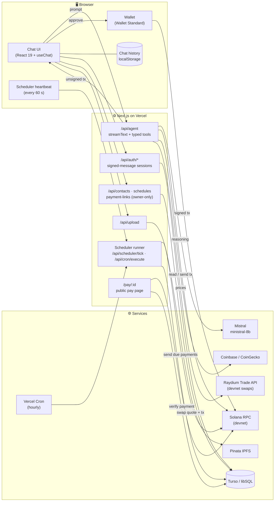
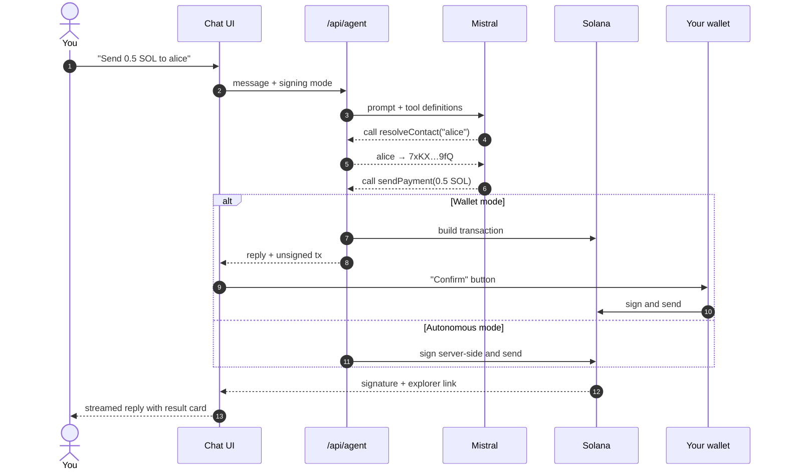
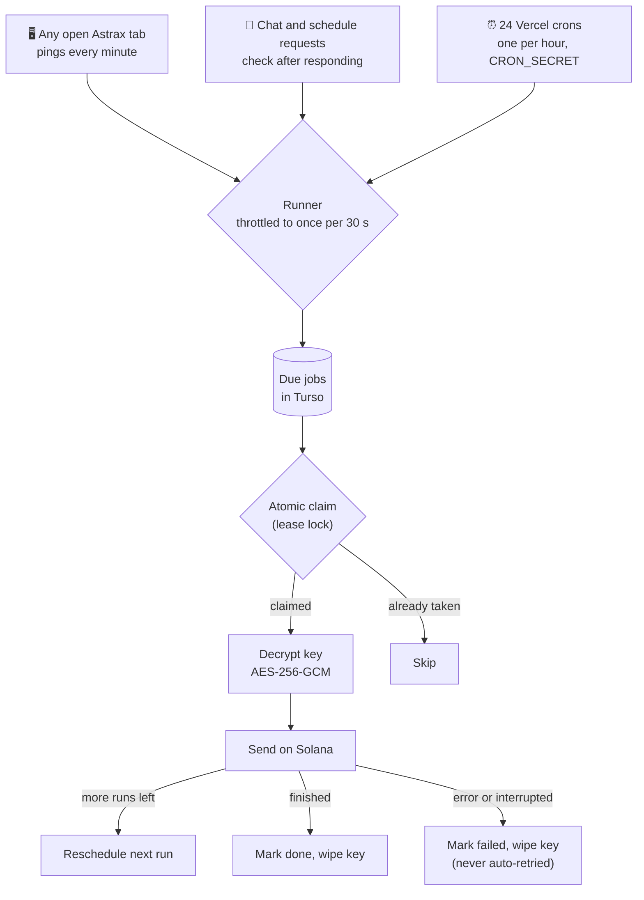
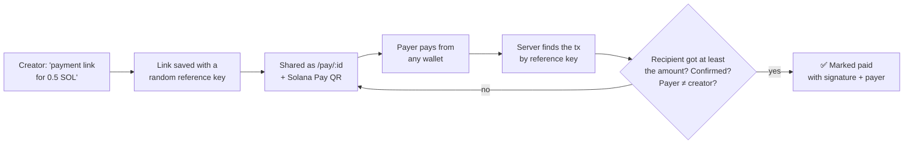

<div align="center">


# Astrax

### Talk to Solana in plain English.

An AI agent that turns a chat message into a real on-chain action: payments, tokens,
NFTs, recurring transfers and self-tracking payment links. You stay in control of
every signature.

[**Live demo**](https://astrax-five.vercel.app) · [Features in depth](FEATURES.md) · [Quick start](#-quick-start)


<br />


</div>

---

## 💡 The problem

Using Solana today means juggling a wallet, an explorer, a token tool, a spreadsheet of
addresses and a calendar reminder for every recurring payment. Every one of those steps
is a place where newcomers give up, or paste the wrong address.

## ✨ The solution

Astrax puts all of it behind one chat box. You say what you want, the agent works out
the steps, calls typed Solana tools, and hands you a transaction to approve, or signs
it for you in hands-free devnet mode.

```text
"What's my SOL balance?"
"Send 0.5 SOL to alice"
"Create a token called MoonCoin, symbol MOON, supply 1,000,000"
"Pay the design team 2 SOL every week, 4 times"
"Make a payment link for 0.5 SOL for logo design"
"Swap 0.01 SOL to USDC"
"Is this token safe? <mint address>"
"Show me the SOL price chart for the last 14 days"
```

---

## 🚀 Features

| | Feature | What it does |
|---|---|---|
| 💸 | **Chat to transact** | Send SOL or any SPL / Token-2022 token, to an address or a saved contact name. |
| 🪙 | **Create tokens and NFTs** | Token-2022 mints with on-chain name and symbol, and 1-of-1 NFTs with IPFS metadata. |
| 🗓️ | **Scheduled payments** | One-off or recurring transfers that go out on their own, even after you close the tab. |
| � | **Token swaps** | Quote and swap SOL, USDC or any devnet token through Raydium's pools, with price impact, minimum received and route. |
| �🔗 | **Self-tracking payment links** | Share a link or Solana Pay QR. Astrax finds the payment on-chain and marks it paid. |
| 🛡️ | **Explain anything** | Paste a transaction, wallet, token or program and get a plain-English breakdown with risk flags. |
| 📈 | **Live market data** | Prices and interactive candlestick charts, rendered right in the chat. |
| 📇 | **Contacts** | A private address book per wallet, so "pay alice" always means *your* alice. |
| 🔐 | **Two signing modes** | Approve each transaction in Phantom, Solflare or Backpack, or go autonomous with a devnet key. |
| 🧠 | **Transparent agent** | Every reply shows the steps and tools it used. Edit, copy or regenerate any message. |
| 🕶️ | **Private chats** | Conversations live only in your browser. Nothing about them is kept on the server. |

Full details for each feature are in [`FEATURES.md`](FEATURES.md).

---

## 🏗️ Architecture

One Next.js app: the UI, the agent and the APIs ship together and deploy to Vercel's
free tier with a free Turso database.



### How a chat message becomes a transaction



### Scheduled payments, with no extra services

Vercel's free plan only allows daily crons, so Astrax combines three triggers. Each one
goes through the same runner, which claims every job atomically in the database before
sending, so a payment can never go out twice.



**Result:** payments go out within about a minute while anyone has the app open, and
within the hour otherwise.

### Payment links that track themselves



---

## 🧰 Tech stack

| Layer | Technology |
|---|---|
| **Framework** | Next.js 15 (App Router), React 19, TypeScript |
| **AI agent** | Vercel AI SDK 4 (`streamText` with tool calling), Mistral `ministral-8b-latest`, Gemini as fallback |
| **Blockchain** | `@solana/web3.js`, `@solana/spl-token` (SPL + Token-2022), `@solana/spl-token-metadata`, Solana Pay |
| **Swaps** | Raydium Trade API on devnet (multi-hop routing across Raydium pools; Jupiter is mainnet-only) |
| **Wallets** | Solana Wallet Adapter with Wallet Standard auto-detection (Phantom, Solflare, Backpack and more) |
| **Database** | libSQL: a local file in development, hosted Turso in production |
| **Storage** | Pinata IPFS for uploads and NFT metadata |
| **Market data** | Coinbase and CoinGecko APIs |
| **Crypto** | AES-256-GCM key encryption, Ed25519 message signing (`@noble/curves`), HMAC sessions |
| **UI** | Tailwind CSS 4, Framer Motion, Lucide icons, react-markdown, Mermaid diagrams |
| **Hosting** | Vercel (Hobby plan) with Vercel Cron |

---

## 🔒 Security model

- **You choose who signs.** In wallet mode every transaction is approved in your own
  wallet, and new token mint keys are generated in the browser so they never leave it.
  Autonomous mode is meant for devnet.
- **Keys are never stored in plain text.** A key used for scheduled payments is
  encrypted with AES-256-GCM and wiped as soon as the schedule ends or is cancelled.
  Keys are sent in the request body, never in the prompt, and never logged.
- **Your data is yours.** Contacts, payment links and schedules are only shown after you
  prove you own the wallet with a free signed message. Messages are single-use, expire
  in 5 minutes and are bound to the site's domain. Sessions are HttpOnly cookies.
- **No double payments.** Confirmed transactions are remembered across reloads, scheduled
  jobs are claimed atomically, and an interrupted send is never retried.
- **Hardened endpoints.** Uploads are rate-limited, size-capped and type-checked. The cron
  endpoint uses a constant-time secret check. Model output is rendered without raw HTML.

---

## 📁 Project structure

```text
app/
  ai-chat/              Chat interface
  pay/[id]/             Public pay page for payment links
  api/
    agent/              The AI agent: streaming + all Solana tools
    auth/               Wallet-ownership sign-in (challenge → verify → session)
    contacts/           Owner-only address book
    payment-links/      Create, list, check and cancel payment links
    schedules/          Owner-only scheduled payments
    scheduler/tick/     Throttled runner triggered by open tabs
    cron/execute/       Runner triggered by Vercel Cron
    upload/             IPFS uploads via Pinata
components/             Chat UI, sidebar, modals, charts, tx buttons
contexts/               Signing mode + owner session state
lib/
  solana.ts · spl.ts    Cluster config, transfers, token and NFT creation
  scheduler.ts          Shared, double-send-safe payment runner
  payment-links.ts      On-chain payment detection
  db.ts                 libSQL schema, migrations and queries
  auth.ts · crypto.ts   Sessions, signatures, key encryption
  explain.ts            Transaction / address risk analysis
```

---

## ⚡ Quick start

```bash
git clone https://github.com/Spydiecy/Astrax_colosseum.git
cd Astrax_colosseum
npm install
cp .env.example .env.local   # add a MISTRAL_API_KEY at minimum
npm run dev
```

Open http://localhost:3000, launch the assistant, and either connect a wallet or paste
a devnet secret key in the sidebar **Signing** panel. Grab free devnet SOL from
[faucet.solana.com](https://faucet.solana.com).

Locally the database is a file created automatically. Every variable is documented in
[`.env.example`](.env.example).

<details>
<summary><b>Deploying to Vercel</b></summary>

<br />

1. Create a free [Turso](https://turso.tech) database and copy its URL and token.
2. Import the repo into Vercel and add the variables from `.env.example`. Generate
   `AUTH_SECRET`, `SCHEDULER_ENC_KEY` and `CRON_SECRET` with `openssl rand -hex 32`.
3. Deploy. Tables are created on the first request, and the hourly crons in
   `vercel.json` are picked up automatically.

</details>

---

## 🗺️ Roadmap

- Mainnet swaps through Jupiter, alongside today's Raydium devnet swaps
- Mainnet support with wallet-only signing
- Payment link webhooks and email receipts
- Multi-recipient and split payments
- Address-book sharing between team wallets

---

<div align="center">

Built on Solana · [Live demo](https://astrax-five.vercel.app)

</div>
